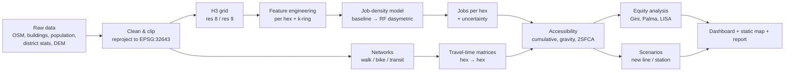

# Almaty Jobs & Accessibility Lab

**Where are the jobs in Almaty, and who can actually reach them?**

An end-to-end Geospatial Data Science project with two parts. First, estimate **where jobs are located** across Almaty on an H3 hexagon grid using only open data and machine learning. Second, measure **how many jobs, schools, clinics and parks each neighborhood can reach** within 15/30/45/60 minutes by walking, cycling and public transport. On top of that, quantify **spatial inequality** in access and present everything in an interactive web dashboard.

> Status: **planning**. This README is the full project plan. Code does not exist yet.

---

## Table of contents

1. [Why this project](#1-why-this-project)
2. [Research questions](#2-research-questions)
3. [Final deliverables](#3-final-deliverables)
4. [Study area and spatial units](#4-study-area-and-spatial-units)
5. [Data sources](#5-data-sources)
6. [Pipeline overview](#6-pipeline-overview)
7. [Phase-by-phase plan](#7-phase-by-phase-plan)
8. [Timeline (sprints)](#8-timeline-sprints)
9. [Repository structure](#9-repository-structure)
10. [Tech stack](#10-tech-stack)
11. [Validation and quality checks](#11-validation-and-quality-checks)
12. [Risks and mitigations](#12-risks-and-mitigations)
13. [Data ethics and work boundaries](#13-data-ethics-and-work-boundaries)
14. [Using Claude Max before it expires](#14-using-claude-max-before-it-expires)
15. [Portfolio and interview angle](#15-portfolio-and-interview-angle)
16. [Stretch goals](#16-stretch-goals)
17. [References](#17-references)

---

## 1. Why this project

- **Real problem.** Transport macromodels need to know where jobs are, because jobs are the main *attractor* of commuting trips. Official statistics usually give totals per district at best. The model needs much finer resolution.
- **Open-data angle.** The project relies only on public data, such as OSM, building footprints, population grids and night lights. Anyone can reproduce it, and it is safe to publish.
- **Covers the full Geospatial DS skill set.** Data engineering, spatial feature engineering, ML with spatial validation, network analysis, spatial statistics, visualization, deployment.
- **Directly useful for transport planning.** Accessibility to jobs is one of the standard indicators planners use to evaluate land use and transport together.

## 2. Research questions

| # | Question | Output |
|---|----------|--------|
| RQ1 | How are jobs distributed across Almaty at ~0.1–0.7 km² resolution? | Job-density map on H3 grid + uncertainty |
| RQ2 | Which open-data features best explain job location? | Feature importance / SHAP analysis |
| RQ3 | How many jobs can residents of each hex reach within 15/30/45/60 min by walk, bike and transit? | Accessibility maps per mode and time threshold |
| RQ4 | How unequal is access across the population and across the 8 districts? | Gini, Palma ratio, Lorenz curves, LISA clusters |
| RQ5 | Where are the "access deserts", meaning many residents but few reachable jobs and services? | Ranked list + map of priority areas |
| RQ6 | How would a new transit line or station change access, and for whom? | Scenario comparison (before/after) |

## 3. Final deliverables

1. **Public GitHub repository** with a reproducible pipeline: `make all` or a single CLI command runs everything from raw data to the final outputs.
2. **Interactive dashboard**, built with Streamlit + pydeck and deployed for free. It includes:
   - hex map with a layer switcher (jobs, population, accessibility per mode/time)
   - click a hex to see what is reachable from it
   - district comparison table and charts
   - scenario toggle (before/after a new line)
3. **Static web map**, built with Kepler.gl or Folium and hosted on GitHub Pages, for people who won't open the app.
4. **Technical report**: this README turned into a case study (problem → data → method → results → limitations).
5. **Notebooks**: EDA, model diagnostics, accessibility results, equity analysis.
6. **Learning guide** (`docs/LEARNING_GUIDE.md`): explains every method in plain words, so every part can be defended in an interview.
7. **Short demo video** (2–3 min) + **LinkedIn/Medium post**.

## 4. Study area and spatial units

- **Study area:** Almaty city administrative boundary from OSM, which covers the 8 districts: Alatau, Almaly, Auezov, Bostandyk, Zhetysu, Medeu, Nauryzbay, Turksib. Add an optional **5 km buffer** so that access near the city edge isn't cut artificially; this is the *edge effect*.
- **Projected CRS:** `EPSG:32643` (WGS 84 / UTM zone 43N) for all distance and area calculations. Use `EPSG:4326` only for storage and web maps.
- **Grid:** Uber **H3**.
  - **Resolution 8** (avg ~0.74 km² per hex) is the main analysis unit, at roughly 1,000 hexes for the city.
  - **Resolution 9** (avg ~0.105 km² per hex) is used for fine maps and the walking analysis, at roughly 7,000 hexes.
  - The reasons for H3: equal-ish areas, clean neighbor rings (k-ring features), fast joins, and native support in pydeck/Kepler.
- **Aggregation units for validation:** the 8 districts, plus any finer official units if statistics exist for them.
- **MAUP awareness:** results depend on grid size, which is the *Modifiable Areal Unit Problem*. Run key results at both res 8 and res 9 and report the differences.

## 5. Data sources

> ⚠️ Check availability, licence and the latest version of each source in Sprint 1. Items marked **(verify)** are uncertain.

### 5.1 Core (required)

| Dataset | What it gives | Format | How to get it | Licence |
|---|---|---|---|---|
| **OpenStreetMap**, via the Geofabrik Kazakhstan extract or Overpass (osmnx) | Road and path network, POIs (shops, offices, schools, clinics, industry), land use, buildings, admin boundaries, transit routes | `.osm.pbf` / GeoParquet | `osmnx` or `pyrosm`/`osmium` | ODbL |
| **Building footprints**: Overture Maps Buildings, or Microsoft Global ML Building Footprints | Footprint area; height or levels where available. Fills gaps in OSM buildings | GeoParquet / GeoJSONL | Overture S3 / Azure blob, using `overturemaps` CLI or DuckDB | ODbL / CDLA |
| **Population grid**: Kontur Population (H3 res 8), or GHSL GHS-POP (100 m), or WorldPop | Residents per hex. Used as the weight for equity analysis | GPKG / GeoTIFF | HDX (Kontur), JRC GHSL portal, WorldPop | CC BY |
| **District employment / enterprise statistics**: Bureau of National Statistics (stat.gov.kz) **(verify)** | Totals per district (number of employed, enterprises, or workplaces). These are the **training targets** for the dasymetric model | XLSX / CSV | Manual download | Open gov data |
| **DEM**: Copernicus GLO-30 or SRTM 30 m | Slope, which matters a lot for walking and cycling in Almaty (the city climbs toward the mountains in the south) | GeoTIFF | OpenTopography / Copernicus | Free |

### 5.2 Optional (adds model power or features)

| Dataset | Use |
|---|---|
| **GHSL GHS-BUILT-S / GHS-BUILT-H** | Built-up surface and building height → estimated floor area |
| **VIIRS night-time lights** (EOG, annual composites; free registration) | Proxy for economic activity |
| **Overture Places** | Extra POIs (business categories), to compare against OSM completeness |
| **GTFS for Almaty public transport** **(verify)** | Real transit travel times with r5py. If no GTFS exists: build a simplified transit network from OSM route relations with assumed speeds and headways (see Phase 4) |
| **Sentinel-2** | Land-cover / NDVI features (industrial vs green vs residential) |
| **Real-estate listings** (commercial rent, office listings) **(check ToS)** | Signal for office density. Use only if terms allow it |

### 5.3 Data storage conventions

- `data/raw/`: original downloads, never modified, git-ignored.
- `data/interim/`: cleaned, clipped, reprojected (GeoParquet).
- `data/processed/`: hex-level feature tables and model outputs (GeoParquet + CSV).
- `data/README.md`: source, download date, version and licence for each file.
- A small **sample dataset** (one district) is committed to the repo for tests and the demo.

## 6. Pipeline overview



## 7. Phase-by-phase plan

### Phase 0: Setup and foundations

**Goal:** a reproducible project skeleton before any analysis.

Tasks:
- [ ] Create a GitHub repo with an MIT licence (code) and a separate data licence note.
- [ ] Environment: `conda`/`mamba` or `uv` with a pinned `environment.yml` / `pyproject.toml`.
- [ ] `config.yaml` holds the study-area name, CRS, H3 resolutions, travel-time thresholds, speeds, file paths and random seed.
- [ ] Package layout `src/almaty_access/` with modules per phase (see §9).
- [ ] CLI using `typer`: `almaty-access download | prepare | features | model | access | equity | report`.
- [ ] `pre-commit` (ruff, black, nbstripout), `pytest`, GitHub Actions CI on the sample dataset.
- [ ] Logging and caching: every step writes GeoParquet and skips work if its output is newer than its inputs.

**Done when:** `pytest` passes in CI and `almaty-access --help` lists all commands.

---

### Phase 1: Data acquisition and cleaning

**Goal:** clean, consistent and documented layers for the study area.

Tasks:
- [ ] **Boundary:** city + 8 districts from OSM (`boundary=administrative`). Fix topology (`make_valid`), dissolve slivers, create the 5 km buffer.
- [ ] **OSM network:** separate graphs for
  - walking (`network_type="walk"`)
  - cycling (`"bike"`)
  - driving (`"drive"`, used for reference only)

  Then simplify, keep the largest strongly connected component, and attach edge lengths.
- [ ] **POIs:** extract by tag groups into a clean category scheme (≈15–25 categories):
  - `office=*`
  - `shop=*`
  - `amenity=*` (restaurant, cafe, bank, school, clinic, hospital, kindergarten, university)
  - `craft=*`
  - `industrial=*`
  - `landuse=industrial|commercial|retail`
  - `tourism=hotel`
  - `building=office|retail|industrial|warehouse|commercial`
  - `public_transport=*`

  Write a mapping table `config/poi_categories.yaml` (tag → category).
- [ ] **Buildings:** merge OSM + Overture/Microsoft footprints by de-duplicating overlaps (IoU > 0.5 → keep OSM attributes). Estimate **floors**: use OSM `building:levels` if present, otherwise GHSL height / 3 m, otherwise a typology default. Compute **gross floor area (GFA)**.
- [ ] **Building function:** classify each building as residential / commercial / industrial / public / unknown, using its tags, the POIs inside it and the land use it sits in.
- [ ] **Population:** Kontur H3 res 8 directly, or GHSL raster → zonal sums per hex. Re-distribute to res 9 by residential floor area (a small dasymetric step).
- [ ] **District statistics:** collect totals (employed / enterprises / workplaces) per district for the latest available year into `data/raw/district_stats.csv`. Document definitions carefully, because "employed residents" is **not** the same as "jobs located in the district".
- [ ] **DEM:** clip, reproject, compute slope; attach elevation to network nodes.
- [ ] **OSM completeness check:** compare OSM building and POI counts against Overture per district. Flag districts with weak coverage, which is important for interpreting the model.

Notebook: `01_data_audit.ipynb`. Maps of every layer, counts per district, missing-value summary.

**Done when:** every layer exists in `data/interim/` as GeoParquet with a documented schema, and the audit notebook shows no obvious gaps.

---

### Phase 2: H3 grid and feature engineering

**Goal:** one tidy table, one row per hex, with ~50–100 features.

Feature groups (computed at res 8 and res 9):

| Group | Examples |
|---|---|
| **Built form** | total footprint area, total GFA, GFA by building function, mean/max floors, building count, share of large buildings (>2,000 m²) |
| **POIs** | counts and densities per category, category diversity (Shannon entropy), share of office/commercial POIs |
| **Land use** | share of hex area by landuse class (industrial, commercial, residential, green) |
| **Network** | intersection density, road length by class, betweenness centrality (sampled), distance to nearest primary road |
| **Transit** | stop count, distance to nearest metro / BRT stop, number of routes serving the hex |
| **Population** | residents, residential GFA, residents per job-related GFA |
| **Centrality** | distance to the historic center, distance to the nearest major sub-center (found by clustering POIs) |
| **Night lights** *(optional)* | mean/sum radiance |
| **Terrain** | mean elevation, mean slope |
| **Neighborhood context** | k-ring (k=1,2) sums and means of key features, because job clusters spill over hex borders |

Tasks:
- [ ] Generate a hex grid covering the study area (`h3.geo_to_cells` / `polygon_to_cells`). Keep hexes whose centroid is inside the buffered boundary.
- [ ] Assign each hex to a district. Hexes cut by a border get an area-weighted assignment.
- [ ] Spatial joins: points → hex via `latlng_to_cell`. Polygons → hex via area-weighted overlay, or via centroid for small buildings.
- [ ] Log-transform skewed counts and record transforms in config.
- [ ] Check feature correlations. Drop or merge near-duplicates (|r| > 0.95).
- [ ] Save `data/processed/features_r8.parquet`, `features_r9.parquet`.

Notebook: `02_features_eda.ipynb`. Distributions, correlation heatmap, maps of the top features, Moran's I of each key feature.

**Done when:** the feature table has no unexplained NaNs, and maps of GFA / POIs visually match what you know about Almaty (for example, a strong center around Almaly / Medeu, plus industrial zones).

---

### Phase 3: Job-density model

**Goal:** an estimate of jobs per hex, with uncertainty and an explanation.

#### 3.1 The core challenge

There is **no open hex-level ground truth** for jobs. Training targets exist only as **district totals**, which gives 8 samples. That is far too few for ordinary supervised ML. The solution is the standard approach from population mapping: **dasymetric disaggregation**.

#### 3.2 Model ladder (from simple to advanced)

**Model A: Floor-area heuristic (baseline)**
- jobs_hex = Σ over building types of GFA × job density coefficient (jobs per 100 m²), for office, retail, industrial and public.
- Coefficients come from the literature or planning norms, and are then **rescaled so that each district's sum equals the official district total**.
- It is transparent and easy to explain, and it is the benchmark every other model must beat.

**Model B: Random-forest dasymetric (main model)**
Follows the WorldPop method (Stevens et al., 2015):
1. Aggregate hex features to district level (sums/means).
2. Target = log(jobs density) per district.
3. To get more than 8 training samples:
   - use finer official units if any exist (sub-district statistics) **(verify)**
   - or use multiple years of district data
   - or train on a related, better-observed target, such as an enterprise count, then convert.
4. Train a Random Forest at the coarse level. Predict at hex level → "weight surface".
5. **Re-scale** the weights inside each district so the hex sum equals the district total (pycnophylactic / mass-preserving constraint).

**Model C: Supervised hex model (optional, only if labels exist)**
- If hex- or point-level job counts become available (from a survey, enterprise registry geocoding, or private data used **only locally**), train LightGBM directly at hex level.
- Use this mode to **validate** Models A and B.

#### 3.3 Validation strategy

- **Leave-one-district-out (LODO):** train on 7 districts, predict the 8th, and compare with its official total.
- **Spatial block cross-validation** for Model C (blocks of k-ring clusters), never random K-fold, because neighboring hexes leak information.
- **Plausibility checks:**
  - top-20 hexes should be known business areas
  - industrial zones should have high jobs and low population
  - big hospitals and universities should appear
- **Ratio sanity:** jobs-to-population ratio per district, compared with intuition and any published commuter data.
- Metrics:
  - district-level: MAE, MAPE, R²
  - hex-level, if labels exist: Spearman rank correlation, top-k precision

#### 3.4 Uncertainty and explanation

- **Uncertainty:** quantile regression forest or bootstrapped forests → P10/P50/P90 jobs per hex. Show this on the dashboard as a "confidence" layer.
- **Explanation:** permutation importance + SHAP (TreeExplainer) → which features drive job density.
- **Sensitivity:** how the result changes with different building-height assumptions and different POI category mappings.

Notebook: `03_job_model.ipynb`.

**Done when:** Model B beats Model A on LODO error, uncertainty maps exist, and the top features make sense.

---

### Phase 4: Travel times and accessibility

**Goal:** jobs and services reachable from every hex, by mode and time threshold.

#### 4.1 Networks and speeds

| Mode | Network | Speed assumption | Slope handling |
|---|---|---|---|
| Walk | OSM walk graph | 4.8 km/h on flat ground | **Tobler's hiking function** per edge using DEM slope |
| Bike | OSM bike graph | ~15 km/h on flat ground | Speed penalty uphill and bonus downhill (capped), plus exclusion of highways where cycling is not allowed |
| Transit | GTFS + walk access/egress | Scheduled times | Departure time window, e.g. weekday 07:00–09:00, median over the window |
| Car *(reference only)* | OSM drive graph | Speed by road class (free-flow) | n/a |

Transit fallback **if no GTFS exists**:
1. Extract `route=bus|trolleybus|subway` relations from OSM.
2. Build a GTFS-like network: assumed average speed per mode (bus vs metro), assumed headways, and wait time = half the headway.
3. Clearly label this in the report as *approximate transit access*.

#### 4.2 Travel-time computation

- Origins and destinations are hex centroids snapped to the nearest network node. Track snapping distance and add it as walk time.
- Walk and bike: convert the graph to a **SciPy sparse matrix** and run `scipy.sparse.csgraph.dijkstra` in batches of origins, with `limit = max threshold`. This is much faster than NetworkX loops.
- Transit: **r5py** (R5 engine; requires Java), giving a travel-time matrix for the departure window.
- Store long-format matrices: `origin_hex, dest_hex, mode, minutes` (Parquet, only pairs ≤ 60 min).

#### 4.3 Accessibility measures

1. **Cumulative opportunities.** A_i(T) = Σ_j O_j · 1[t_ij ≤ T] for T ∈ {15, 30, 45, 60} min. It is easy to explain ("jobs within 30 minutes").
2. **Gravity / Hansen.** A_i = Σ_j O_j · exp(−β · t_ij). Calibrate β from a target half-life (e.g. 20 min) and test sensitivity.
3. **Two-Step Floating Catchment Area (2SFCA)** for services with **capacity and competition** (clinics, schools, kindergartens). This accounts for many people competing for the same facility.
4. **Nearest-facility time.** Minutes to the nearest school / clinic / park / metro station.
5. **Normalized indices.** Accessibility as % of all city jobs, so walk vs transit vs car are comparable.

Opportunity types: jobs (from Phase 3), schools, kindergartens, clinics/hospitals, parks/green areas (> 1 ha), grocery shops.

Notebook: `04_accessibility.ipynb`.

**Done when:** each hex has accessibility values per mode × threshold × opportunity type, and spot-checks against a routing app make sense for 10 random origin–destination pairs.

---

### Phase 5: Equity and spatial statistics

**Goal:** show *who* is underserved and *where*.

Tasks:
- [ ] **Population-weighted distributions:** for each measure, a Lorenz curve, the **Gini coefficient** and the **Palma ratio** (top 10% vs bottom 40%).
- [ ] **District comparison:** population-weighted mean/median accessibility per district, plus a ranking.
- [ ] **Mode gap:** the ratio of transit to car accessibility per hex. High gaps mean car dependence.
- [ ] **Spatial autocorrelation:** global Moran's I; **LISA** (local Moran) to find statistically significant cold spots (low-access clusters) and hot spots. Use PySAL (`libpysal`, `esda`).
- [ ] **Access deserts:** hexes with population above the 75th percentile and accessibility below the 25th percentile. Rank them by affected population.
- [ ] **Bivariate maps:** population × accessibility (3×3 bivariate color scheme).
- [ ] **Optional:** relate access to socio-economic proxies, such as housing type or distance to the center, if open data exists.

Notebook: `05_equity.ipynb`.

**Done when:** you can state the result in one sentence with numbers (e.g. "X% of residents can reach fewer than Y% of city jobs within 45 min by transit, concentrated in …").

---

### Phase 6: Scenario analysis

**Goal:** show the planning value of the tool.

- Define a scenario as a GeoJSON: new stations and/or new lines with an assumed speed and headway.
- Rebuild the transit network with the scenario → recompute travel times → recompute accessibility.
- Outputs:
  - change map (Δ jobs reachable)
  - population gaining > X jobs
  - change in Gini (does the project reduce or increase inequality?)
- Prepare 2–3 scenarios. Examples: a metro extension, a BRT corridor, a new bike lane network (bike speed boost on selected streets).

Notebook: `06_scenarios.ipynb`.

---

### Phase 7: Dashboard and maps

**Goal:** a non-technical person can explore the results in 30 seconds.

Dashboard (Streamlit + pydeck `H3HexagonLayer`):
- **Sidebar:** layer (jobs / population / accessibility / gap / LISA), mode, time threshold, opportunity type, scenario on/off.
- **Main map:** hexes colored by the selected measure, with a tooltip showing all values.
- **Click a hex:** highlight reachable hexes (an isochrone-like view) and show a small table of reachable jobs/services.
- **District panel:** bar charts + Lorenz curves.
- **"Method" tab:** a short explanation, data sources and limitations.
- **Downloads:** CSV/GeoParquet of the results.

Performance: preload results as Parquet, cache with `st.cache_data`, and keep the click-to-reach matrix only for res 8 to stay within free hosting limits.

Deploy: Streamlit Community Cloud or Hugging Face Spaces (free). Add a static Kepler.gl / Folium map on GitHub Pages.

---

### Phase 8: Packaging, report and publication

- [ ] README rewritten as a **case study**: problem, data, approach, 3–4 key maps, key numbers, limitations, next steps.
- [ ] `docs/METHODS.md` with formulas, `docs/DATA.md` with sources and licences, `docs/LEARNING_GUIDE.md`.
- [ ] Test coverage of the core functions (grid, joins, dasymetric rescaling, accessibility formulas, Gini).
- [ ] Final figures exported at 300 dpi to `reports/figures/`.
- [ ] 2–3 minute screen-recorded demo of the dashboard.
- [ ] LinkedIn post + Medium/Habr article (English version for international applications).
- [ ] Add the project to your CV with 2–3 quantified bullet points.

## 8. Timeline (sprints)

One sprint ≈ 1 week, at ~8–12 hours per week.

| Sprint | Focus | Key output |
|---|---|---|
| 1 | Phase 0 + start Phase 1 | Repo, environment, config, CI; boundary + OSM network downloaded |
| 2 | Phase 1 | All layers cleaned; data audit notebook |
| 3 | Phase 2 | Feature tables r8/r9; feature EDA |
| 4 | Phase 3 (A + B) | Baseline + RF dasymetric model; LODO validation |
| 5 | Phase 3 (uncertainty + SHAP) | Job map with P10/P50/P90; explanation notebook |
| 6 | Phase 4 (walk, bike) | Travel-time matrices; cumulative + gravity access |
| 7 | Phase 4 (transit + 2SFCA) | Transit access (GTFS or OSM fallback); service access |
| 8 | Phase 5 | Equity metrics, LISA, access deserts |
| 9 | Phase 6 + Phase 7 | Scenarios; dashboard v1 deployed |
| 10 | Phase 8 | Case-study README, video, post, CV update |

**Minimum viable version** (if time gets short): Sprints 1–4 + walk/transit cumulative access + a simple dashboard. That is already a strong portfolio piece.

## 9. Repository structure

```
almaty-jobs-access/
├── README.md                    # this plan → later the case study
├── LICENSE
├── pyproject.toml / environment.yml
├── Makefile                     # make data / features / model / access / app
├── config/
│   ├── config.yaml              # CRS, H3 res, thresholds, speeds, paths, seed
│   ├── poi_categories.yaml      # OSM tag → category mapping
│   ├── job_coefficients.yaml    # jobs per 100 m² by building type (Model A)
│   └── scenarios/               # scenario GeoJSONs
├── data/
│   ├── README.md                # source, date, licence of each file
│   ├── raw/   interim/   processed/   (git-ignored)
│   └── sample/                  # small committed sample (one district)
├── src/almaty_access/
│   ├── cli.py                   # typer CLI
│   ├── config.py
│   ├── io.py                    # read/write GeoParquet, caching
│   ├── download/                # osm.py, buildings.py, population.py, dem.py, gtfs.py
│   ├── prepare/                 # boundary.py, network.py, pois.py, buildings.py
│   ├── grid.py                  # H3 grid, polygon→hex, area weights
│   ├── features.py
│   ├── model/                   # baseline.py, dasymetric_rf.py, supervised.py, validate.py, explain.py
│   ├── access/                  # speeds.py, travel_times.py, transit.py, measures.py (cumulative, gravity, 2sfca)
│   ├── equity.py                # gini, palma, lorenz, lisa, deserts
│   ├── scenarios.py
│   └── viz.py                   # shared map styles, colormaps
├── notebooks/
│   ├── 01_data_audit.ipynb
│   ├── 02_features_eda.ipynb
│   ├── 03_job_model.ipynb
│   ├── 04_accessibility.ipynb
│   ├── 05_equity.ipynb
│   └── 06_scenarios.ipynb
├── app/
│   └── streamlit_app.py
├── tests/
├── docs/
│   ├── METHODS.md
│   ├── DATA.md
│   └── LEARNING_GUIDE.md
└── reports/figures/
```

## 10. Tech stack

| Area | Tools |
|---|---|
| Core | Python 3.11+, pandas, NumPy, GeoPandas, Shapely 2, pyproj |
| Data access | osmnx, pyrosm / pyosmium, DuckDB (+ spatial extension) for Overture, rasterio, rasterstats / exactextract |
| Grid | h3 (v4), h3pandas *(optional)* |
| ML | scikit-learn, LightGBM, quantile-forest, SHAP |
| Networks | networkx, SciPy sparse graph, r5py (+ Java 21) for transit |
| Spatial stats | libpysal, esda, mapclassify |
| Viz | matplotlib, contextily, pydeck, Kepler.gl, Folium |
| App | Streamlit |
| Engineering | typer, pytest, ruff, pre-commit, GitHub Actions, Make |
| Desktop GIS | QGIS for visual checks (and comparison with Visum zone layers at work, private only) |

## 11. Validation and quality checks

| Stage | Check |
|---|---|
| Data | CRS consistent; no invalid geometries; counts per district vs Overture; duplicates removed |
| Grid | Sum of hex areas ≈ study area; every hex has a district; population sum ≈ official city total (±10%) |
| Features | No unexplained NaNs; distributions logged; leakage review (no target-derived features) |
| Model | District sums match official totals exactly after rescaling; LODO error reported; plausibility top-20 list |
| Travel times | 10 random O–D pairs compared with a routing app; walk times symmetric; no unreachable hexes without explanation |
| Accessibility | Monotonic in T (30 min ≥ 15 min); gravity β sensitivity reported |
| Equity | Gini computed with population weights; Lorenz curve plotted; LISA uses permutation p-values with FDR awareness |
| App | Loads in < 5 s on free hosting; works on mobile width |

## 12. Risks and mitigations

| Risk | Impact | Mitigation |
|---|---|---|
| District employment stats unavailable or ambiguous | Model B has no target | Use enterprise counts or published city totals; fall back to Model A with clear caveats; present the job map as a "relative intensity" index |
| Only 8 districts → overfitting at coarse level | Unstable weights | Keep the RF small, use strong regularization, compare with Model A, report LODO honestly; add more years or finer units if found |
| OSM incomplete in some districts (POIs, building levels) | Biased job map | Merge with Overture/Microsoft footprints; completeness audit; uncertainty layer |
| No GTFS for Almaty | No scheduled transit times | OSM-route fallback with assumed speeds/headways, labelled "approximate" |
| r5py / Java setup issues on Windows | Lost time | Use Docker or WSL; or do transit last and ship walk/bike first |
| Large matrices (res 9 × res 9) | Memory | Limit to ≤ 60 min pairs, batch Dijkstra, store sparse long format, res 8 for transit |
| Scope creep | Never finished | Minimum viable version defined (§8); stretch goals kept separate (§16) |

## 13. Data ethics and work boundaries

- **The public repo uses open data only.** Internal data of organizations (Visum model, zone matrices, internal surveys) stays **out of the repository and out of all published outputs**.
- If internal data is useful for validation, do that **privately and locally**, and only publish the method, not the numbers.
- Respect licences: OSM (ODbL) needs attribution and share-alike for derived databases. Credit every source in the app and README.
- No personal data. All results are aggregated to hexes.
- Be explicit about limitations: modeled jobs are **estimates**, not counts.

## 14. Using Claude Max before it expires

Use the remaining time for the parts that are heavy on code and design. Learn by reading and running the result.

Priority order:
1. **Skeleton + config + CLI + CI** (Phase 0). Fast, high leverage.
2. **Data preparation modules** (Phase 1): OSM extraction, building merge, POI category mapping.
3. **Grid + features** (Phase 2), with tests on the sample dataset.
4. **Accessibility engine** (Phase 4): sparse Dijkstra, cumulative/gravity/2SFCA, Tobler slope speeds.
5. **Dasymetric model + LODO validation** (Phase 3).
6. **Dashboard skeleton** (Phase 7).
7. **LEARNING_GUIDE.md**, explaining each module so you can continue alone after the subscription ends.

Working rules:
- Ask for one module per session. Save every file immediately to your own GitHub.
- For each module, ask for: code + tests + a short "how it works" explanation.
- Keep a `DECISIONS.md` log (what was chosen and why). It is useful for interviews and for continuing without Claude.

## 15. Portfolio and interview angle

Skills this project demonstrates:
- Building a reproducible geospatial data pipeline from multiple open sources.
- Spatial feature engineering on a discrete global grid (H3).
- ML **without direct labels**: dasymetric disaggregation, mass-preserving constraints.
- **Spatial cross-validation** and honest uncertainty reporting.
- Network analysis at scale (sparse graph algorithms, transit routing with r5py).
- Spatial statistics (Moran's I, LISA) and equity metrics (Gini, Palma).
- Turning analysis into a deployed product for non-technical users.

Example CV bullets (fill in the real numbers later):
- *Built an open-data pipeline estimating job density for ~1,000 H3 hexes in Almaty with a random-forest dasymetric model (LODO MAPE X%).*
- *Computed walk/bike/transit accessibility to jobs and services for N residents; identified access deserts affecting X% of the population.*
- *Deployed an interactive Streamlit + pydeck dashboard with scenario analysis of new transit lines.*

## 16. Stretch goals

- **Graph neural network** on the hex adjacency graph for job density (compare with RF).
- **Satellite-image features** (Sentinel-2 embeddings, or a pretrained geospatial foundation model) as extra model inputs.
- **Commute flow model:** a doubly-constrained gravity model using population (origins) and modeled jobs (destinations) → synthetic OD matrix, compared conceptually with the macromodel.
- **Time-of-day accessibility** (peak vs off-peak transit).
- **Multi-city comparison** (Almaty vs Astana vs Shymkent) using the same pipeline.
- **Kazakh/Russian/English** language switch in the dashboard.

## 17. References

- Stevens, F. R., Gaughan, A. E., Linard, C., & Tatem, A. J. (2015). Disaggregating census data for population mapping using random forests with remotely-sensed and ancillary data. *PLOS ONE*.
- Hansen, W. G. (1959). How accessibility shapes land use. *Journal of the American Institute of Planners*.
- Geurs, K. T., & van Wee, B. (2004). Accessibility evaluation of land-use and transport strategies: review and research directions. *Journal of Transport Geography*.
- Luo, W., & Wang, F. (2003). Measures of spatial accessibility to health care in a GIS environment: synthesis and a case study in the Chicago region. *Environment and Planning B*.
- Pereira, R. H. M., Schwanen, T., & Banister, D. (2017). Distributive justice and equity in transportation. *Transport Reviews*.
- Tobler, W. (1993). Three presentations on geographical analysis and modeling (hiking function). NCGIA.
- Anselin, L. (1995). Local indicators of spatial association — LISA. *Geographical Analysis*.
- Roberts, D. R. et al. (2017). Cross-validation strategies for data with temporal, spatial, hierarchical, or phylogenetic structure. *Ecography*.
- Documentation: H3 (h3geo.org), OSMnx, r5py, PySAL, Overture Maps, Kontur Population, GHSL.
